# Awesome Order Processing & Fulfillment 📦🚀

  

  
  
  
  
  
  

---

> 🎯 **Awesome Order Processing & Fulfillment** is a curated list of top Order Management Systems (OMS), Warehouse Management Systems (WMS), 3PL logistics networks, shipping automation tools, and self-hosted open-source operations hubs. Whether you are running high-velocity omnichannel DTC retail, B2B wholesale distribution, or setting up automated micro-fulfillment warehouses, discover production-ready tools for managing inventory, tracking stock movements, orchestrating pick-pack-ship pipelines, and connecting carrier APIs.
> 
> 🌟 **Star this repository if you find it valuable!** 🌟

---

## 📑 Table of Contents
- [📈 Sector Overview & Market Dynamics](#-sector-overview--market-dynamics)
- [🏢 SaaS & Hosted Commercial Platforms](#-saas--hosted-commercial-platforms)
- [⚡ Open-Source Software & Self-Hosted Solutions](#-open-source-software--self-hosted-solutions)
  - [InvenTree](#inventree)
  - [Fleetbase](#fleetbase)
  - [GreaterWMS](#greaterwms)
  - [ModernWMS](#modernwms)
  - [OpenShip](#openship)
  - [OpenBoxes](#openboxes)
  - [org.openwms](#orgopenwms)
  - [Sentry WMS](#sentry-wms)
  - [OpenOMS](#openoms)
  - [OverSeek](#overseek)
  - [KubeRiva OMS](#kuberiva-oms)
- [📊 Feature Comparison Matrix](#-feature-comparison-matrix)
- [🤝 Contributing](#-contributing)
- [💖 Support](#-support)
- [⭐ Star History](#-star-history)
- [📄 License](#-license)

---

## 📈 Sector Overview & Market Dynamics

The global e-commerce order processing and fulfillment market is currently valued between **$135 billion and $160 billion** and is projected to surpass **$300+ billion by 2032**, expanding at a robust compound annual growth rate (CAGR) of **9.5% to 14.5%**. 

From a structural standpoint, the sector is **moderately to highly fragmented** at the broader ecosystem level, powered by thousands of regional third-party logistics (3PL) providers, niche warehouse operators, and specialized software vendors catering to SMEs. While mega-enterprises like Amazon FBA, DHL Supply Chain, FedEx, and UPS control massive captive volumes, the middle-market and SaaS layer remains fiercely competitive with continuous modularization across OMS, WMS, and autonomous shipping engines.

---

## 🏢 SaaS & Hosted Commercial Platforms

Commercial, cloud-hosted Order Processing, WMS, and Multi-Channel Fulfillment platforms. The table below is sorted descending by company scale (valuation / market capitalization / revenue context).

| Platform 🏷️ | Primary Focus 🎯 | Scale & Size (Valuation / Revenue) 💰 | Pricing (Starting Tier) 💵 | Free Tier Limits / Trial Period ⏱️ | Key Features ⚙️ |
| :--- | :--- | :--- | :--- | :--- | :--- |
| **[ShipStation](https://www.shipstation.com)** | Multi-Carrier Shipping & Label Automation | **$6.6 Billion** (Part of Auctane / Thoma Bravo acquisition of Stamps.com; processes millions of shipments daily) | **$14.99 / month** (*Starter Plan* for up to 50 shipments/month) | **30-day free trial** with full access to Starter tier features (carrier postage billed separately) | Multi-carrier rate discounts, 180+ store & marketplace integrations, automated order imports, batch label printing, tracking portals. |
| **[ShipBob](https://www.shipbob.com)** | Tech-Enabled 3PL & Global Fulfillment Network | **$1.0B – $2.0B+ Valuation** ($100M–$500M+ annual revenue; raised over $330M in Series E/F funding) | **$35 – $40 / hour** receiving + **$5 / bin / month** storage + custom per-order pick/pack rates (first 4 picks included) | **No free trial** (requires physical onboarding consultation; offers live platform demo & sample cost modeling) | Distributed warehouse network, 2-day domestic delivery, B2B wholesale fulfillment, custom branded packaging, live analytics portal. |
| **[Brightpearl](https://www.brightpearl.com)** | Omnichannel Retail Operating System (ROS / ERP) | **$380 Million (£299M)** (Acquired by Sage Group in 2021; powers $5M+ enterprise retailers) | **$1,000 / month** (Baseline entry tier for high-volume multichannel retailers) | **No free trial** (enterprise consultation and live product architecture demonstration required) | Built-in retail accounting, real-time demand forecasting, automated order workflows, POS integration, multi-channel stock sync. |
| **[Cin7](https://www.cin7.com)** | Inventory Management & Multichannel ERP | **$35M+ ARR / Mid-Market PE Leader** (Backed by Rubicon Technology Partners; acquired DEAR Systems) | **$349 / month** (*Cin7 Core Standard Plan*, billed annually) | **14-day free trial** for Cin7 Core with standard features, up to 5 users, and 6,000 order/year simulation (no credit card required) | Deep B2B portal, manufacturing & assembly BOMs, EDI retail connections, 450+ integrations, warehouse barcode scanning. |
| **[Skubana (Extensiv)](https://www.extensiv.com)** | High-Volume Multichannel Operations & OMS | **Acquired by Extensiv (3PL Central)** (Extensiv is a premier PE-backed logistics platform managing thousands of 3PLs) | **$1,000 / month** (Starting rate for Extensiv Order Manager enterprise volume) | **No free trial** for Order Manager (requires custom technical onboarding; demo available via sales engineers) | Multi-warehouse order routing, algorithmic profitability analytics, cross-channel inventory buffers, purchase order automation. |

---

## ⚡ Open-Source Software & Self-Hosted Solutions

Explore production-ready open-source Order Management Systems (OMS), Warehouse Management Systems (WMS), and modern logistics operating systems. Sorted in descending order by GitHub stargazers count.

### InvenTree 
* **Repository:** [inventree/InvenTree](https://github.com/inventree/InvenTree) 📦
* **Stack:** Python / Django / React / PostgreSQL / Redis | **License:** MIT
* **Focus:** Open-Source Inventory & Order Management System
* **Overview:** InvenTree is a lightweight yet enterprise-capable open-source inventory management and order tracking system. It provides powerful low-level stock control, part tracking, supplier purchasing, customer sales orders, bill of materials (BOM) management, and modular REST API interfaces.
* **Best for:** Manufacturing operations, electronics hardware teams, and businesses requiring granular part-level inventory control paired with incoming and outgoing order fulfillment.

---

### Fleetbase 
* **Repository:** [fleetbase/fleetbase](https://github.com/fleetbase/fleetbase) 🚚
* **Stack:** JavaScript / PHP / MySQL / Ember.js | **License:** AGPL-3.0
* **Focus:** Modular Logistics and Supply Chain Operating System (LSOS)
* **Overview:** Fleetbase is an extensible, modular open-source logistics engine providing last-mile delivery orchestration, driver routing, fleet tracking, and automated fulfillment workflows. It features a dedicated WooCommerce plugin that synchronizes orders directly into delivery dispatch workflows with zero per-delivery commissions.
* **Best for:** On-demand delivery services, hyper-local logistics providers, and merchants running self-operated courier fleets.

---

### GreaterWMS 
* **Repository:** [GreaterWMS/GreaterWMS](https://github.com/GreaterWMS/GreaterWMS) 🏭
* **Stack:** Python / Django / Vue.js / Quasar / Android / iOS | **License:** Apache-2.0
* **Focus:** Ford AP Supply Chain Warehousing & Space Sharing WMS
* **Overview:** Developed based on the Ford Asia Pacific after-sales warehousing supply chain processes, GreaterWMS is a comprehensive warehouse management platform supporting multi-location inventory, warehouse space sharing, barcode scanning, bin location allocation, and cross-platform mobile apps for hand-held terminal scanning.
* **Best for:** Manufacturing warehouses, enterprise supply chain centers, and shared logistics hubs needing proven multi-platform pick-and-pack management.

---

### ModernWMS 
* **Repository:** [fjykTec/ModernWMS](https://github.com/fjykTec/ModernWMS) 📋
* **Stack:** .NET Core / Vue.js / TypeScript / SQL Server / MySQL | **License:** MIT
* **Focus:** Cross-Platform Warehouse Management for SMEs
* **Overview:** ModernWMS was extracted from enterprise ERP implementations to give small- and medium-sized enterprises a clean, production-ready, and lightweight WMS. It covers the full cycle of inbound goods, shelving, wave picking, outbound delivery, inventory counting, and multi-warehouse allocations.
* **Best for:** Small and medium enterprises (SMEs) seeking an accessible, cross-platform warehouse management system with an active global community.

---

### OpenShip 
* **Repository:** [openshiporg/openship](https://github.com/openshiporg/openship) 🔄
* **Stack:** Node.js / Next.js / Keystone.js / GraphQL | **License:** Apache-2.0
* **Focus:** Open-Source Multichannel Order Router & Fulfillment Automation
* **Overview:** OpenShip is a headless, programmable order routing engine connecting sales channels (Shopify, WooCommerce, custom marketplaces) directly to fulfillment warehouses, suppliers, and dropshippers. It allows automated rule-based order splitting, carrier rate selection, and drop-ship fulfillment routing.
* **Best for:** E-commerce businesses needing a dedicated order orchestrator to split and route customer orders dynamically to multiple suppliers or 3PL facilities.

---

### OpenBoxes 
* **Repository:** [openboxes/openboxes](https://github.com/openboxes/openboxes) 🏥
* **Stack:** Java / Groovy / Grails / MySQL | **License:** EPL-1.0
* **Focus:** Healthcare & Humanitarian Facility Supply Chain Management
* **Overview:** OpenBoxes is a specialized warehouse and supply chain management system engineered for hospitals, public health facilities, and humanitarian disaster relief missions. It manages cold-chain storage, lot tracking, expiration date enforcement, stock requisitions, and end-to-end movement of medical products.
* **Best for:** Healthcare systems, non-profit humanitarian organizations, and pharmaceutical distributors requiring stringent lot and expiration tracking.

---

### org.openwms 
* **Repository:** [openwms/org.openwms](https://github.com/openwms/org.openwms) 🏗️
* **Stack:** Java / Spring Boot / Microservices / Angular | **License:** Apache-2.0
* **Focus:** Distributed Modular Warehouse Management & Material Flow Control
* **Overview:** OpenWMS is a modern, modular, distributed warehouse management system built using Spring Boot microservices. It covers transport unit management, receiving, storage location management, automated conveying system control, and material flow tracking in highly automated warehouse environments.
* **Best for:** Enterprise logistics engineers, automated conveyor setups, and facilities needing microservices-based material handling and warehouse process automation.

---

### Sentry WMS 
* **Repository:** [hightower-systems/sentry-wms](https://github.com/hightower-systems/sentry-wms) 🔍
* **Stack:** Node.js / Express / REST API | **License:** MIT
* **Focus:** API-First E-Commerce Warehouse Operations Engine
* **Overview:** Sentry WMS provides a granular REST API for every fundamental warehouse operation: barcode verification, receiving, bin transfers, wave picking, batch walk-path optimization, cycle counts, short-pick alerts, and packing verification.
* **Best for:** Technical e-commerce teams wanting an API-first backend to power custom warehouse handheld apps, barcode scanners, and packing bench terminals.

---

### OpenOMS 
* **Repository:** [openoms-org/openoms](https://github.com/openoms-org/openoms) 🌐
* **Stack:** Go / TypeScript / PostgreSQL / Redis | **License:** ELv2 / MIT
* **Focus:** High-Performance Multi-Channel E-Commerce OMS
* **Overview:** OpenOMS is an end-to-end open-source Order Management System for retail and e-commerce. It features hundreds of API endpoints, dozens of integration SDKs (including marketplace adapters), and a complete admin dashboard for tracking orders from checkout to shipment delivery.
* **Best for:** E-commerce companies desiring a self-hosted, scalable Go/TypeScript stack with rich integration capabilities and an out-of-the-box management dashboard.

---

### OverSeek 
* **Repository:** [MerlinStacks/overseek](https://github.com/MerlinStacks/overseek) 🧭
* **Stack:** Node.js / TypeScript / PostgreSQL / Redis / Docker | **License:** MIT
* **Focus:** Self-Hosted Operations & Order Fulfillment Hub for WooCommerce
* **Overview:** OverSeek acts as a private, unified operations cockpit for WooCommerce merchants. It integrates order synchronization, fulfillment tracking with direct carrier tracking links, purchase orders, vendor context, and customer messaging into an installable Docker-based workspace.
* **Best for:** WooCommerce store owners looking for a private, self-hosted operational dashboard to consolidate order fulfillment, stock levels, and carrier tracking.

---

### KubeRiva OMS 
* **Repository:** [KubeRiva/OMS](https://github.com/KubeRiva/OMS) 🤖
* **Stack:** Python / FastAPI / PostgreSQL / MongoDB / Redis / Elasticsearch | **License:** MIT
* **Focus:** AI-Native Order Sourcing & Distributed Fulfillment OMS
* **Overview:** KubeRiva OMS is an AI-driven, distributed order management system designed as a self-hosted alternative to six-figure enterprise SaaS platforms. It includes 7 automated sourcing strategies with node scoring, geo-distance calculations, a 15-state order state machine, and natural language fulfillment rule configuration.
* **Best for:** Omnichannel brands seeking AI-optimized inventory routing, split fulfillment logic, and multi-channel marketplace order aggregation.

---

## 📊 Feature Comparison Matrix

| Software / Project 💻 | Type 🏷️ | GitHub Stars ⭐ | Primary License ⚖️ | Tech Stack 🛠️ | OMS Focus 📦 | WMS Focus 🏭 | Self-Hosted 🏠 | Target Use Case 🎯 |
| :--- | :--- | :--- | :--- | :--- | :---: | :---: | :---: | :--- |
| **[InvenTree](https://github.com/inventree/InvenTree)** | Open Source | 7,857+ | MIT | Python / Django / React | ✅ | ✅ | ✅ | Granular part & assembly inventory + sales orders |
| **[Fleetbase](https://github.com/fleetbase/fleetbase)** | Open Source | 4,643+ | AGPL-3.0 | JS / PHP / MySQL | ✅ | ⚠️ Delivery | ✅ | Last-mile delivery, fleet routing & WooCommerce dispatch |
| **[GreaterWMS](https://github.com/GreaterWMS/GreaterWMS)** | Open Source | 4,455+ | Apache-2.0 | Python / Vue / Quasar | ⚠️ | ✅ | ✅ | Ford AP supply chain warehousing & space-sharing |
| **[ModernWMS](https://github.com/fjykTec/ModernWMS)** | Open Source | 1,811+ | MIT | .NET Core / Vue / TS | ❌ | ✅ | ✅ | SME multi-location warehouse operations |
| **[OpenShip](https://github.com/openshiporg/openship)** | Open Source | 1,673+ | Apache-2.0 | Node.js / Next.js / GraphQL | ✅ | ⚠️ Routing | ✅ | Multichannel order routing, splitting & dropship rules |
| **[OpenBoxes](https://github.com/openboxes/openboxes)** | Open Source | 929+ | EPL-1.0 | Groovy / Grails / MySQL | ❌ | ✅ Healthcare | ✅ | Medical supply chain, cold storage & humanitarian aid |
| **[org.openwms](https://github.com/openwms/org.openwms)** | Open Source | 764+ | Apache-2.0 | Java / Spring Boot / Angular | ❌ | ✅ Microservices | ✅ | Automated material flow control & conveyor management |
| **[Sentry WMS](https://github.com/hightower-systems/sentry-wms)** | Open Source | 43+ | MIT | Node.js / REST API | ⚠️ | ✅ Granular API | ✅ | Barcode-driven e-commerce warehouse API backend |
| **[OpenOMS](https://github.com/openoms-org/openoms)** | Open Source | 33+ | ELv2 / MIT | Go / TypeScript / Postgres | ✅ | ⚠️ Basic | ✅ | Full-scale self-hosted e-commerce order management |
| **[OverSeek](https://github.com/MerlinStacks/overseek)** | Open Source | 29+ | MIT | Node.js / Postgres / Docker | ✅ WooCommerce | ✅ Inventory | ✅ | WooCommerce private ops hub & fulfillment tracker |
| **[KubeRiva OMS](https://github.com/KubeRiva/OMS)** | Open Source | 23+ | MIT | Python / FastAPI / MongoDB | ✅ AI-Native | ⚠️ Node Routing | ✅ | AI sourcing strategies & multi-channel routing |

---

## 🤝 Contributing

Contributions, feature suggestions, and new additions are always welcome! 

If you know of an awesome open-source Order Processing, WMS, or Fulfillment system that belongs in this repository:
1. Fork this repository 🍴
2. Create a new branch (`git checkout -b feature/add-new-project`) 🌿
3. Add the project with its name, GitHub repository link, star badge, tech stack, license, and a concise 1–2 sentence description 📝
4. Ensure the list remains sorted by GitHub stars in descending order 📊
5. Commit your changes and open a Pull Request 🚀

---

## 💖 Support

Thank you for exploring this curated directory! If you found this repository helpful, please consider supporting the project:

- ⭐ **Star this repository** on GitHub to help others discover it
- 🍴 **Fork and contribute** by adding new tools, updating documentation, or submitting PRs
- 📢 **Share** this list with colleagues, engineering teams, and founders
- ☕ **Buy a coffee & sponsor** continuous open-source maintenance via the [GitHub Sponsor Dashboard](https://github.com/sponsors/ishandutta2007)

Your support keeps this project active, comprehensive, and up-to-date!

---

##  Star History

---

## 📄 License

This repository and curated collection are released under the [Creative Commons Zero v1.0 Universal](LICENSE) (Public Domain Dedication). All software packages, trademarks, and logos belong to their respective project maintainers and organizations.

---

  <b>⭐ Found this useful? Star the repository to support future updates! ⭐</b> 
  Maintained with ❤️ by the open-source e-commerce and logistics community.

